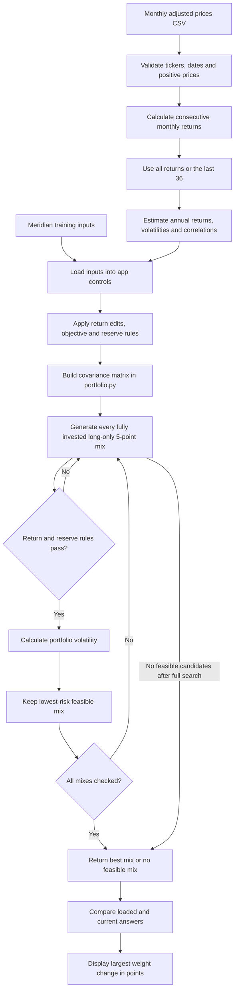

# Lab 15 - Portfolio Stability Decision

## D - The question and my answer

Which mix carries the least risk while meeting the mandate, and does the answer survive a one-point change in one estimate?

For Meridian, the lowest-risk mix on the 5-point grid is 0% bills, 20% Treasury notes, 25% IG bonds and 55% equity. Cutting the equity return estimate from 8% to 7% moves equity up to 80%. That is a 25-point change from changing just one estimate.

For my Campus Scholarship Reserve, the full five-year sample selects 75% SGOV and 25% VT. The last 36 months select 90% SGOV and 10% VT, a 15-point change. A one-point cut to VT's full-sample return estimate leaves the original weights unchanged, but the expected portfolio return drops to just 5.51%. My call is to **pilot the full-sample mix**, because the sample-window change and the small return cushion make immediate adoption hard to justify.

## R - My universe and mandate

My fictional client is the Campus Scholarship Reserve from Lab 13: a $1 million fund with a seven-year horizon and $10,000 quarterly scholarship payments.

- **Return objective:** CPI + 3%, using a labelled CPI estimate of 2.5%, gives a 5.5% annual expected-return target.
- **Reserve constraint:** At least $40,000, or 4% of the starting portfolio, in eligible reserves. SGOV and SCHR are marked eligible under the classroom government-security rule.
- **Allocation rules in this app:** Fully invested, long-only, with weights in 5-percentage-point steps.

The 4% minimum stays at 4% in the controls. Because the grid uses 5-point steps, the smallest nonzero reserve allocation it can choose is 5%.

| Ticker | Fund | Role | Price source | Download date |
|---|---|---|---|---|
| SGOV | iShares 0-3 Month Treasury Bond ETF | Short-term Treasury reserves | [Yahoo Finance](https://finance.yahoo.com/quote/SGOV/history/) | October 22, 2026 |
| SCHR | Schwab Intermediate-Term U.S. Treasury ETF | Government bonds | [Yahoo Finance](https://finance.yahoo.com/quote/SCHR/history/) | October 22, 2026 |
| USIG | iShares Broad USD Investment Grade Corporate Bond ETF | Investment-grade corporate bonds | [Yahoo Finance](https://finance.yahoo.com/quote/USIG/history/) | October 22, 2026 |
| VT | Vanguard Total World Stock ETF | Global stocks | [Yahoo Finance](https://finance.yahoo.com/quote/VT/history/) | October 22, 2026 |

The fund choices and issuer sources are explained in [lab14.md](lab14.md#before-thursday---my-fund-universe). Four funds give each role a clear purpose without adding separate stock-region decisions to the search.

[prices.csv](prices.csv) contains 61 month-end adjusted prices per fund from September 30, 2021 through September 30, 2026. Each observation is the last trading day's Yahoo adjusted close for that month. There are no missing prices or filled-in observations. The initial price gives a starting point for 60 monthly returns, covering October 2021 through September 2026. The recent window uses 37 prices to calculate 36 returns from October 2023 through September 2026.

The exact source requests, timestamp and selected source values are saved in [data/prices_source.json](data/prices_source.json). Adjusted prices account for distributions and splits. Fund operating expenses are already reflected in the historical fund prices, so the calculation does not subtract them twice. Trading costs and any client-specific costs are not modeled.

## I - The engine and the app

The calculations live in [portfolio.py](portfolio.py). [app.py](app.py) imports that engine and provides the controls and results. It does not contain a second copy of the portfolio math.

Run the baseline checker and launch the app:

```sh
python portfolio.py
python -m streamlit run app.py
```

If installing dependencies on another computer:

```sh
python -m pip install -r requirements.txt
```

The app starts with Meridian at a 6.5% objective and a 3% reserve minimum. Each return estimate is editable, and each asset has a reserve-eligible checkbox. The page shows the original answer beside the current scenario and reports the largest weight change in percentage points. If there is no feasible grid mix, it displays `no mix meets the objective` instead of changing the target.

For my own funds, select **Campus Scholarship Reserve** or upload `prices.csv`. The app recognizes these four tickers and starts at 5.5% return and 4% reserves. The **Use last 36 months** switch recomputes return estimates, volatilities and correlations. Changing the window resets the editable returns to that window's estimates. The loaded comparison always uses the full sample; both columns use the same current objective and reserve eligibility rules.

### How the data becomes an answer



The chart documents the implemented engine. It is an AI-assisted diagram, not a record of the separate no-AI paper exercise.

### What the calculations do

For each fund, monthly return is `current adjusted price / previous adjusted price - 1`. Annual expected return is the arithmetic average monthly return multiplied by 12. Annual volatility is the sample monthly standard deviation multiplied by the square root of 12. The sample standard deviation uses `n - 1`, and correlations come from the same selected monthly return observations. These are **estimates**, not forecasts or promised returns; the arithmetic annual estimate is not CAGR.

`weight_grid()` splits 20 units across the assets, where each unit is 5%. The last asset receives the units left over, so every mix sums to 100% and no weight is negative. With four assets, it tries 1,771 distinct mixes.

`search_portfolio()` first validates the inputs and builds the covariance matrix. It then loops through the grid, calculates expected return and eligible reserves, and skips any mix that misses either requirement. For each feasible mix it calls the existing volatility function. It replaces the saved best result only when the new mix has lower volatility, then returns that result after checking the whole grid. If no mix qualifies, it returns `None`. A tiny tolerance handles floating-point rounding at an exact constraint boundary.

The answer is the lowest estimated volatility **on this grid**. A continuous optimizer could find different weights between the 5-point steps. Equal-risk ties keep the first mix in the engine's fixed enumeration order.

### Code questions and answers

**Why does the last asset receive the remaining units?** It guarantees a total of 100% and avoids checking combinations that are not fully invested. Since the earlier assets can use only the units still available, the last weight cannot be negative.

**Why check return and reserves before calculating risk?** A portfolio that fails either rule cannot be the answer, even if its volatility is low. Skipping it also avoids an unnecessary risk calculation.

**Why can lowering the equity return estimate make the answer hold more equity?** The target stays fixed. In Meridian, equity still has the highest expected return after the cut, so the search needs more equity to reach 6.5%. That raises the selected portfolio's risk.

**Why are 37 prices needed for 36 months?** A return uses two adjacent prices. The first price is the starting value, so 37 prices provide 36 returns.

**What if no allocation reaches the target?** The engine returns `None`, and the app says no mix meets the objective. I would report infeasibility rather than lower the objective to manufacture an answer.

## V - Meridian verification

These are computed results from the engine and Streamlit tests, not values typed into the app.

| Run | Bills | 10-year | IG bonds | Equity | Return estimate | Volatility | Eligible reserves |
|---|---:|---:|---:|---:|---:|---:|---:|
| As loaded | 0.00% | 20.00% | 25.00% | 55.00% | 6.51% | 9.44% | 20.00% |
| Equity estimate reduced from 8% to 7% | 0.00% | 10.00% | 10.00% | 80.00% | 6.53% | 12.94% | 10.00% |
| IG-equity correlation changed to 0.50, equity estimate at 8% | 0.00% | 40.00% | 0.00% | 60.00% | 6.52% | 9.73% | 40.00% |

The largest weight change in the one-point return test is **25 points**, from 55% to 80% equity. Its volatility rises from 9.44% to 12.94%, a 3.50-point increase. The displayed portfolio return rises slightly because the allocation changes; the original mix did not become more profitable.

For the engine-link test, the verification script temporarily saved 0.50 in both IG-equity correlation cells in `portfolio.py`, ran the app, and checked the displayed 0/40/0/60 result. It then restored the original file and checked that the app returned to 9.44% volatility. Both saved correlations are back at 0.25.

The Lab 14 console output was compared before and after the additions and is unchanged character for character. All five Lab 14 checks and all eleven Lab 15 checks passed. The Lab 15 checks cover the known answers, complete grid enumeration, sample calculations, the 36-month boundary, invalid CSVs, reserve toggles, return edits and reset, file loading, infeasibility, and the saved engine change.

```sh
python verify_lab14.py
python verify_lab15.py
```

Streamlit's AppTest checked the app's displayed tables and controls. Its upload tests supplied a file-like object because the test API does not offer direct file-uploader interaction. The running server also returned `ok` from its health endpoint. An interactive browser visual check was not available in this session.

## My universe - all months versus the last 36

The objective stays at **5.5%** and the reserve minimum stays at **4%** in both runs. SGOV and SCHR count as reserves in the classroom model.

| Fund | Full-sample annual return estimate | Full-sample annual volatility | Last-36 annual return estimate | Last-36 annual volatility |
|---|---:|---:|---:|---:|
| SGOV | 3.72% | 0.50% | 4.44% | 0.21% |
| SCHR | -0.30% | 5.41% | 3.53% | 4.65% |
| USIG | 0.12% | 7.86% | 5.21% | 6.18% |
| VT | 11.90% | 14.92% | 20.25% | 11.71% |

| Run | SGOV | SCHR | USIG | VT | Return estimate | Volatility | Eligible reserves | Feasible mixes |
|---|---:|---:|---:|---:|---:|---:|---:|---:|
| All 60 monthly returns | 75.00% | 0.00% | 0.00% | 25.00% | 5.76% | 3.82% | 75.00% | 408 |
| Last 36 monthly returns | 90.00% | 0.00% | 0.00% | 10.00% | 6.02% | 1.21% | 90.00% | 1,335 |

The largest allocation change is **15 points**: SGOV rises from 75% to 90%, while VT falls from 25% to 10%. On the initial $1 million portfolio, that is a $150,000 shift. This is a comparison of two estimated portfolios, not an executed trade.

The recent sample gives SGOV a higher estimated return and gives VT a much higher estimated return with lower estimated volatility. As a result, the search needs less stock exposure to meet the same 5.5% target. The correlations also change when the window changes. Neither sample selects SCHR or USIG: in these estimated inputs, they do not improve the lowest-risk feasible grid mix enough to displace SGOV and VT. That does not mean those funds are always useless.

I would not treat VT's recent 20.25% annual arithmetic estimate as a dependable future return. It is a major reason the recent-window mix can look unusually safe while still clearing the target.

## Challenge test - simulated partner attack

**Challenge:** The full-sample VT estimate of about 11.90% looks optimistic. What happens if it is one percentage point lower, with everything else unchanged?

This challenge was simulated with AI and run through the actual engine and app controls. It is not attributed to a classmate.

| Test | SGOV | SCHR | USIG | VT | Return estimate | Volatility | Largest weight change |
|---|---:|---:|---:|---:|---:|---:|---:|
| Full-sample starting point | 75.00% | 0.00% | 0.00% | 25.00% | 5.76% | 3.82% | 0.00 points |
| VT estimate minus 1.00 point | 75.00% | 0.00% | 0.00% | 25.00% | 5.51% | 3.82% | 0.00 points |
| Extra engine probe: VT estimate minus 1.10 points | 70.00% | 0.00% | 0.00% | 30.00% | 5.84% | 4.55% | 5.00 points |

**My two-sentence response:** A one-point cut to VT's estimate leaves the 75% SGOV / 25% VT weights unchanged, but the estimated return falls to 5.51%, barely above the 5.5% target. I would not call that strong stability, because a 1.1-point cut changes the answer to 70% SGOV / 30% VT and raises estimated volatility to 4.55%.

The one-point reduction changes the unrounded portfolio return from 5.7601% to 5.5101%. The remaining margin is only about 0.0101 percentage points, roughly one basis point. The 5-point grid can hide sensitivity until a constraint boundary is crossed, so an unchanged allocation is not enough evidence by itself.

## My call

**Pilot the full-sample 75% SGOV / 25% VT mix as the Project 2 starting allocation.** It meets the modeled 5.5% objective and 4% reserve constraint, and the reserve sleeve fits the scholarship-payment role. I would use the full sample as the starting case rather than switch to 90% SGOV just because the recent sample has higher estimated returns.

I would consider adoption only after the mix still meets the objective using independently supported forward-looking assumptions and realistic client costs, and after the remaining mandate rules are checked. The specific concern is that a one-point VT reduction nearly removes the return cushion and a 1.1-point reduction pushes stock exposure up by 5 points. If a reasonable conservative assumption set makes the target infeasible, I would report that result and reconsider the starting mix with the client rather than silently change the target.

This app checks the return and reserve rules plus fully invested long-only weights. It does not verify annual turnover, execution liquidity, rebalancing history or a calendar-year loss limit. In particular, annual volatility is not a guarantee that losses stay below a specified amount.

## Estimation risk

Estimation risk is the chance that the numbers used to choose the portfolio are wrong or unrepresentative of the future. A five-year sample can give a different answer from a three-year sample even when the client has not changed.

The optimizer amplifies errors because it treats the supplied estimates as exact and chooses the mix that just gets through the constraints at the lowest modeled risk. A small change can remove the previous winner from the feasible set. On a discrete grid, the next feasible choice can be several percentage points away.

My own results show two versions of that problem. Changing the estimation window moves 15% of the portfolio between SGOV and VT. Cutting only VT's expected return by 1.1 points moves 5% into stocks, even though the stock-return assumption became less attractive, because more stocks are needed to reach the unchanged target.

## Reflection

**Why did the lowest-risk mix move?** The goal and reserve rule stayed fixed, but the estimates of return, volatility and correlation changed. The recent sample makes the target look achievable with much less equity. The search responds to those estimates, not to certainty about what will happen next.

**What would I need before adopting it?** I would want a credible explanation for the return assumptions, checks across more periods and adverse scenarios, realistic costs, and a review of every mandate rule. I would also want to understand the small return cushion under the one-point test instead of relying on the fact that the displayed weights stayed the same.

## Files and reproducibility

- [app.py](app.py): Streamlit interface.
- [portfolio.py](portfolio.py): original baselines, CSV estimator, grid search and comparison calculation.
- [prices.csv](prices.csv): sourced monthly adjusted prices.
- [data/prices_source.json](data/prices_source.json): download provenance and source observations.
- [data/lab15_results.json](data/lab15_results.json): computed estimates and scenario results, regenerated by the verification script.
- [verify_lab15.py](verify_lab15.py): engine and app checks.
- [requirements.txt](requirements.txt): Streamlit dependency.

The code, written answers and simulated challenge were prepared with AI help. The in-person paper drawing, no-AI oral explanation, classmate exchange and Brightspace quiz are separate class activities and are not claimed as completed here.

Assignment: [Lab 15 - Portfolio Stability Decision](https://github.com/CinderZhang/FIN43900-Fall2026/blob/main/lessons/week-09/lab-15-portfolio-stability.md).
